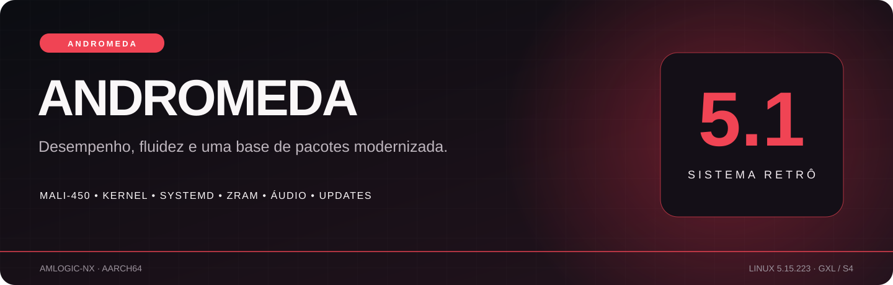

<strong>A sua biblioteca. A sua identidade. Uma nova geração de recursos.</strong>

<a href="https://github.com/NextOs-Ports/Retro-Elite-5.1/releases">ROM e atualizações</a> · <a href="docs/RECURSOS.md">Todos os recursos</a> · <a href="docs/DISPOSITIVOS.md">Dispositivos</a> · <a href="docs/INSTALACAO.md">Instalação</a> · <a href="docs/ATUALIZACOES.md">Como atualizar</a>

# Retro Elite 5.1 · Andromeda

Uma evolução ampla da experiência Retro Elite: interface, identidade do jogador, biblioteca, controles, memória, manutenção, integração de suporte e distribuição de atualizações. A edição5.1 reúne o trabalho acumulado da linhaAmlogic-nx em uma imagem cumulativa.

> **Revisão privada do lançamento.** Este repositório está privado por escolha do proprietário enquanto a apresentação e a documentação são aprovadas. A distribuição R2 existente está preservada. A ROM e o primeiro pacote de atualização ficam na aba **Releases**.

| Identidade | Edição5.1 |
|---|---|
| Nome da edição | **Andromeda** |
| Arquitetura | **AArch64** |
| Família da imagem | **Amlogic-nx · GXL/S4** |
| Kernel Linux | **5.15.223** |
| Primeira entrega neste repositório | `r175-andromeda · UID20261102070544` |
| Instalação nova | Imagem `.img.gz` para cartão |
| Atualização de instalação compatível | Pacote nativo `-update.zip` |
| Acesso a este repositório | Documentação e binários de distribuição; sem código da ROM |

**5.1 é a versão da Retro Elite; 5.15.223 é a versão do kernel Linux.** A compatibilidade depende de SoC, placa, memória, DTB e periféricos reais. O nome comercial de uma box, sozinho, não determina compatibilidade.

## Comece por aqui

1. Confira [a matriz de dispositivos](docs/DISPOSITIVOS.md).
2. Baixe a [ROM ou atualização correta em Releases](https://github.com/NextOs-Ports/Retro-Elite-5.1/releases).
3. Siga [a instalação em cartão](docs/INSTALACAO.md) ou [a atualização nativa](docs/ATUALIZACOES.md).
4. Explore [as novidades e os recursos próprios](docs/RECURSOS.md).
5. Consulte [memória, ZRAM, boot e desempenho](docs/DESEMPENHO.md) e [as dúvidas frequentes](docs/FAQ.md).

## O que já faz parte desta entrega

### Uma primeira configuração que termina de verdade

O assistente de cinco passos permite informar o nome do jogador e concluir a preparação do sistema. A confirmação final fecha o assistente por completo. O teclado virtual também recebeu a correção do evento de liberação de Esc, que fechava o editor assim que ele era aberto em certas configurações de controle.

### O nome do jogador percorre a experiência

O mesmo nome pode ser editado em **Tela e aparência → Meu perfil → Nome do jogador**, aparece na saudação e identifica os dispositivos cadastrados no suporte autorizado. A restauração ou remoção do nome se propaga ao painel. Isso não altera identidade técnica, conta, chave de instalação nem autorização de suporte.

### Exclusivos com apresentação e acesso coerentes

A arte do menu fica contida na área correta. O catálogo pode ser consultado, e a lista não abre por trás de uma atualização ativa. Consulta de títulos e download de pacotes privados são operações diferentes; as contas e permissões continuam controlando os downloads correspondentes.

### Java e reinicialização para cartão

O Java JM padrão é compilado de fonte pública, com controles, entrada, migração e bibliotecas revisados. Os avisos e a fonte correspondente acompanham o componente. O aplicativo próprio **Reiniciar Retro Elite1.2** solicita a reinicialização para cartão quando os privilégios do Android permitem; o APK CoreELEC5.0 mantém sua identidade e seus avisos.

### Manutenção que respeita os dados

A entrega inclui a criação/verificação do STORAGE, recuperação e correções de boot, atualização cumulativa nativa e preservação das configurações verificadas. A recuperação Bluetooth S4 protege armazenamento em uso e limita tentativas de reset.

A descrição completa por áreas está sendo consolidada em [Recursos](docs/RECURSOS.md), sem reduzir a edição a essa introdução. Os textos de dispositivos e desempenho vinculam cada afirmação à implementação e às provas disponíveis.

## ROM e update: qual baixar?

| Arquivo da release | Finalidade |
|---|---|
| `Retro-Elite-5.1-… .img.gz` | Instalação em cartão. A gravação apaga o conteúdo do cartão selecionado. |
| `Retro-Elite-5.1-…-update.zip` | Atualização nativa de uma instalação compatível. |
| `SHA256SUMS` | Conferência dos arquivos baixados. |
| `SHA256SUMS.sig` e `update-signing.pub` | Assinatura Ed25519 e chave pública de distribuição. |
| `manifest.json` e `release.json` | Versão, UID, tamanho, hashes e identidade da entrega. |

**Os downloads automáticos “Source code” do GitHub são apenas os arquivos de documentação deste repositório. Eles não são a imagem da ROM nem o update.**

## Distribuição e segurança

Os arquivos da primeira release mantêm exatamente os bytes da entrega já aprovada. O repositório é independente do desenvolvimento privado: nenhum histórico de código da ROM foi importado para cá.

A integração em preparação usa **GitHub como origem principal e R2 como reserva**, com manifesto assinado e identidade imutável do pacote. A chave privada de assinatura e as credenciais de publicação ficam fora da ROM e deste repositório; somente a chave pública é distribuída. Enquanto o repositório estiver privado, o cliente anônimo não terá acesso aos arquivos do GitHub e deverá usar a reserva R2. Consulte [Atualizações](docs/ATUALIZACOES.md) para o estado de cada entrega.

## Compatibilidade e limites que importam

- TX9 e Aquário passaram na atualização física da entrega inicial desta página. D905 e X2 mantêm os alcances de suas aprovações anteriores.
- No Aquário, o host USB CRG pode interferir no Bluetooth quando um controle USB low-speed está sendo lido. O alcance depende da combinação de periféricos.
- O APK não concede privilégios que o Android não oferece. Acesso root ou autorização compatível podem ser necessários.
- Ganhos de boot, RAM e desempenho são apresentados com seu contexto; não representam um ganho universal de FPS.
- As licenças de terceiros continuam aplicáveis. A documentação específica do blob VPU permanece uma questão separada para revisão antes da abertura pública.

## Documentação

| Guia | Conteúdo |
|---|---|
| [Recursos](docs/RECURSOS.md) | Novidades, menus e recursos próprios |
| [Dispositivos](docs/DISPOSITIVOS.md) | Famílias, SoCs, placas, memória e alcance de suporte |
| [Desempenho](docs/DESEMPENHO.md) | Boot, RAM, ZRAM, fluidez e medições com contexto |
| [Instalação](docs/INSTALACAO.md) | Cartão, DTB, primeiro boot e APK |
| [Atualizações](docs/ATUALIZACOES.md) | Releases, assinatura, GitHub, R2 e recuperação |
| [Histórico](docs/HISTORICO.md) | Evolução cumulativa da5.1 |
| [FAQ](docs/FAQ.md) | Dúvidas do uso diário |
| [Créditos e licenças](docs/CREDITOS-E-LICENCAS.md) | Base, autores, componentes e avisos |

## Comunidade e relato de problemas

Ao relatar um problema, informe versão/UID, SoC e memória, modelo da placa quando conhecido, tipo de cartão e passos para reproduzir. Não publique senhas, tokens, chaves, códigos de suporte, arquivos completos de contas ou imagens do seu cartão com dados pessoais.

A Retro Elite utiliza e reconhece o trabalho do projeto **EmuELEC** e de diversos autores upstream. Desenvolvimento próprio e integrações são identificados na documentação; o crédito de um componente continua sendo de seus autores.
