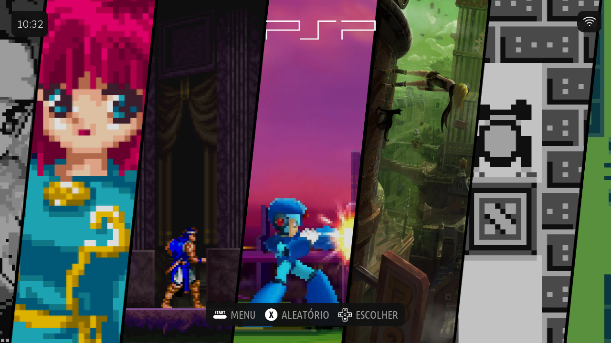
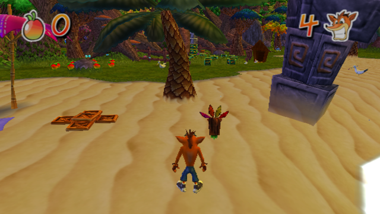
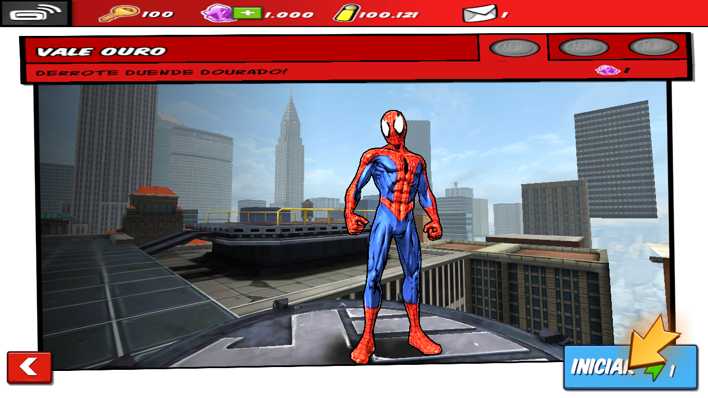
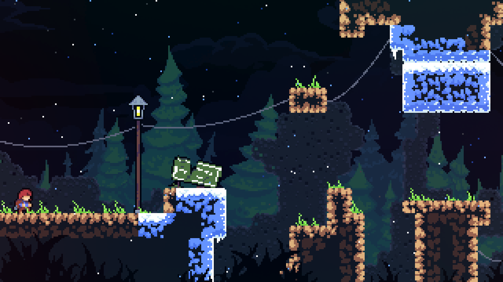
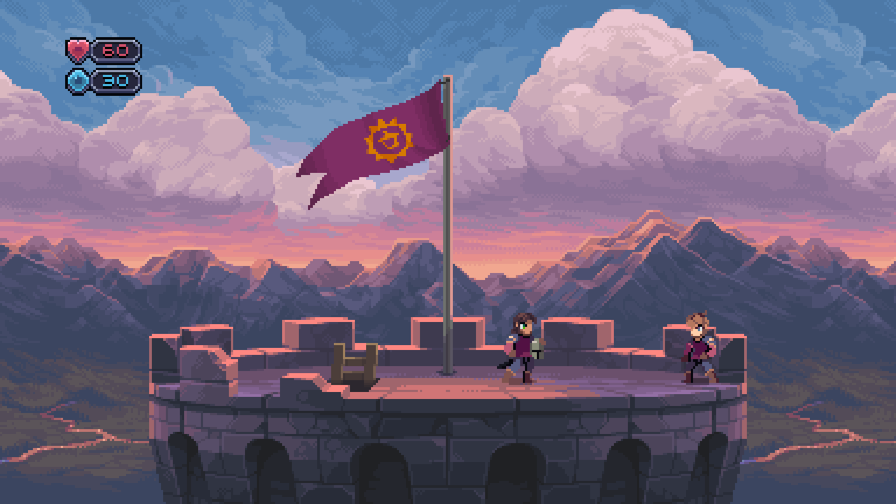

# Galeria · NEXTOS 5.1

**A imagem é virgem.** Jogos, coleções e sistemas de jogo dos exemplos aparecem conforme o usuário adiciona seu conteúdo e não acompanham a distribuição. As capturas são reais, sem logos/molduras Retro Elite adicionados.

## Interface e tema

Captura nativa1280×720, com conteúdo adicionado pelo usuário. O carrossel ilustra o tema após a instalação de jogos.

## Memória e ZRAM

Tela real de memória, com ZRAM512MiB no aparelho de2GB. O uso de memória varia com a sessão; os valores da captura não são uma promessa para todos os aparelhos.

## Exemplos de ports

A curadoria reúne até quatro registros de ports do ecossistema, com a versão/data identificadas na legenda quando disponíveis. Os jogos ilustrados não fazem parte da imagem virgem.

Os registros abaixo são capturas preservadas do acervo do projeto, com data e versão indicadas; não substituem a matriz de compatibilidade da release.

### Crash Twinsanity

Crash Twinsanity — registro do acervo no NextOS,31/10/2026. Captura original640×360. O jogo não acompanha a imagem virgem.

### Spider-Man Unlimited

Spider-Man Unlimited — prévia de missão no NextOS, registro do acervo de30/10/2026, port r051. O jogo não acompanha a imagem virgem.

### Celeste

Celeste — registro do acervo no NextOS5.0,19/10/2026. O jogo não acompanha a imagem virgem.

### Chasm

Chasm — registro do acervo no NextOS5.0,19/10/2026. O jogo não acompanha a imagem virgem.
