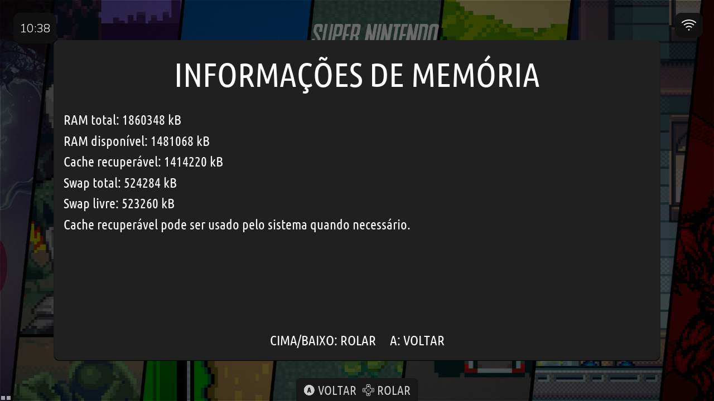

# Galeria · Retro Elite5.1

**A imagem é virgem.** Jogos, coleções e sistemas de jogo dos exemplos aparecem conforme o usuário adiciona seu conteúdo e não acompanham a distribuição. As capturas são reais, sem logos/molduras Retro Elite adicionados.

## Interface e tema

Captura nativa1280×720, com conteúdo adicionado pelo usuário. O carrossel ilustra o tema após a instalação de jogos.

## Memória e ZRAM

Tela real de memória, com ZRAM512MiB no aparelho de2GB. O uso de memória varia com a sessão; os valores da captura não são uma promessa para todos os aparelhos.

## Exemplos de ports

A curadoria reúne até quatro registros de ports do ecossistema, com a versão/data identificadas na legenda quando disponíveis. Os jogos ilustrados não fazem parte da imagem virgem.
