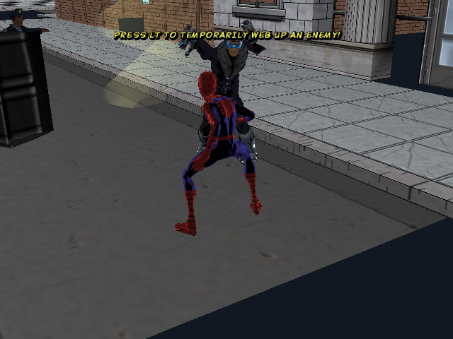
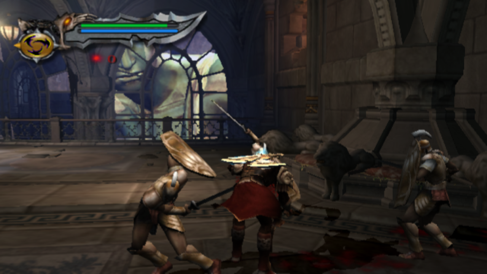
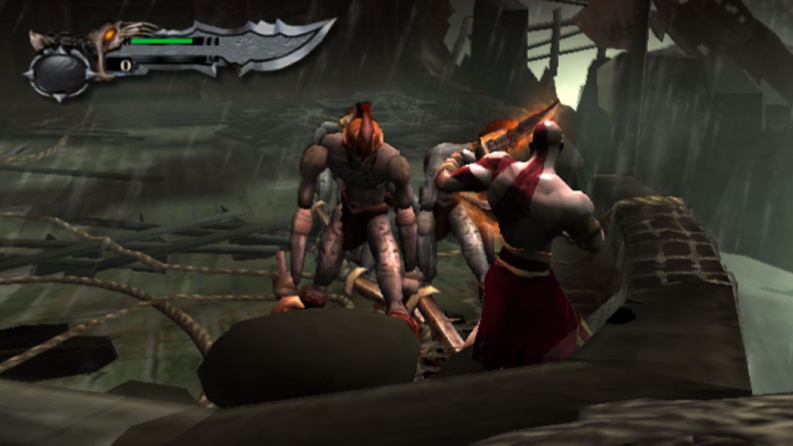

# Galeria · NEXTOS 5.1

**A imagem é virgem.** Jogos, coleções e sistemas de jogo dos exemplos aparecem conforme o usuário adiciona seu conteúdo e não acompanham a distribuição. As capturas são reais, sem logos/molduras Retro Elite adicionados.

## Interface e tema

Captura nativa1280×720, com conteúdo adicionado pelo usuário. O carrossel ilustra o tema após a instalação de jogos.

## Memória e ZRAM

Tela real de memória, com ZRAM512MiB no aparelho de2GB. O uso de memória varia com a sessão; os valores da captura não são uma promessa para todos os aparelhos.

## Exemplos de ports

A curadoria reúne até quatro registros de ports do ecossistema, com a versão/data identificadas na legenda quando disponíveis. Os jogos ilustrados não fazem parte da imagem virgem.

Os registros abaixo são capturas preservadas do acervo do projeto, com data e versão indicadas; não substituem a matriz de compatibilidade da release.

### Crash Twinsanity

Crash Twinsanity — registro do acervo no NextOS,31/10/2026. Captura original640×360. O jogo não acompanha a imagem virgem.

### Ultimate Spider-Man (PC, 2005)

Ultimate Spider-Man (versão PC de 2005) — registro do acervo no NextOS, 16/10/2026. Captura original 640×480. O jogo não acompanha a imagem virgem.

### God of War II

God of War II — combate no port da coleção, registro do acervo no NextOS, 07/10/2026. Captura original 1280×720. O jogo não acompanha a imagem virgem.

### God of War

God of War — combate no navio do Mar Egeu, registro do acervo no NextOS, 14/09/2026. Captura original 1280×720. O jogo não acompanha a imagem virgem.
